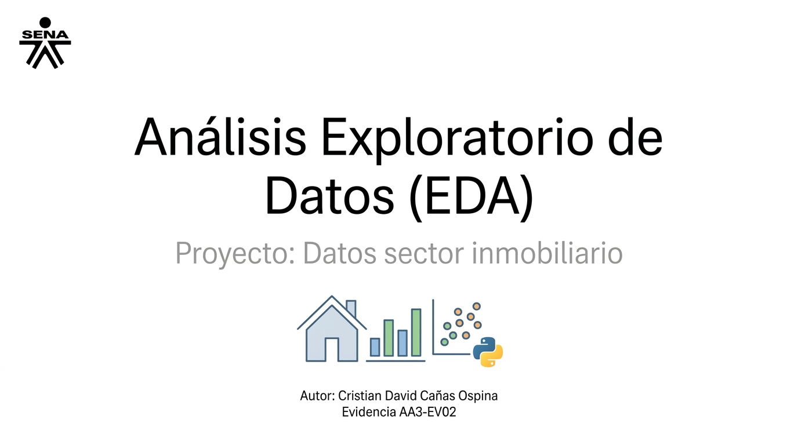

*Imagen de presentación generada con inteligencia artificial.*

## Información del proyecto

- Evidencia: AA3-EV02.
- Curso: Análisis Exploratorio de Datos en Python.
- Autor: Cristian David Cañas Ospina.
- GitHub: [cd7-gis](https://github.com/cd7-gis).
- Notebook principal: [analisis_inmobiliario](/analisis_inmobiliario_EDA.ipynb).

## Descripción

Este proyecto desarrolla un análisis exploratorio para curso del SENA análisis exploratorio de datos en Python, quien en su actividad proponen el  conjunto de datos
inmobiliarios, esta compuesto por 463 registros y 12 columnas originales.

Se examinan los precios, el área construida, el área del terreno y el tipo de
inmueble. El trabajo incluye exploración inicial, revisión de valores
faltantes, tratamiento de duplicados, estadística descriptiva y
visualizaciones.

Los resultados describen exclusivamente el conjunto de datos analizado y no
se consideran representativos de todo el mercado inmobiliario del país.

## Pregunta objetivo

¿Cómo se relacionan el área construida, el área del terreno y el tipo de
inmueble con los precios registrados, y qué características presentan sus
distribuciones estadísticas?

## Herramientas utilizadas

- Python.
- pandas.
- NumPy.
- Matplotlib.
- Seaborn.
- Jupyter Notebook.
- Visual Studio Code.

El notebook se desarrolló inicialmente en Jupyter Notebook.

## Datos

Archivo de entrada: `Data_Caso_Propuesto.csv`.

El conjunto de datos contiene las siguientes columnas:

| Columna | Descripción |
|---|---|
| Codigo | Identificador del registro. |
| Ciudad | Ciudad registrada. |
| Departamento | Departamento registrado. |
| Barrio | Barrio o sector informado. |
| Direccion | Dirección del inmueble. |
| Area Terreno | Área del terreno, analizada en m². |
| Area Construida | Área construida, analizada en m². |
| Detalle Disponibilidad | Información sobre disponibilidad. |
| Estrato | Categoría de estrato registrada. |
| Precio | Precio registrado, analizado en COP. |
| Tipo de Inmueble | Tipología del inmueble. |
| Datos Adicionales | Información complementaria. |

El archivo CSV no se incluye de forma predeterminada en el repositorio.
Para ejecutar el análisis, debe obtenerse de la fuente autorizada y
colocarse en la carpeta `data`.

La fuente original y las condiciones de uso deben verificarse antes de
redistribuir los datos.

## Estructura del proyecto

```text
.
├── analisis_inmobiliario_EDA.ipynb
├── README.md
├── requirements.txt
├── .gitignore
├── LICENSE
├── imagenes/
│   ├── presentacion.jpg
|   ├── DiseñO sin título.png  
|   └── logo-de-SENA.png
└── data/
    ├── Data_Caso_Propuesto.csv
    └── analisis_inmobiliario_EDA.ipynb - Colab.pdf
```

## Ejecución en VS Code

### 1. Preparar el proyecto

Descarga o clona el repositorio y abre su carpeta principal en VS Code.

### 2. Crear un entorno virtual

En una terminal de Windows:

```powershell
python -m venv .venv
```

### 3. Instalar las dependencias

```powershell
.\.venv\Scripts\python.exe -m pip install -r requirements.txt
```

### 4. Ubicar los datos

Crea la carpeta `data` y coloca dentro el archivo:

```text
data/Data_Caso_Propuesto.csv
```

### 5. Configurar la carga del CSV

Para ejecutar localmente, utiliza esta celda en lugar de las instrucciones
de montaje de Google Drive:

```python
from pathlib import Path
import pandas as pd

ruta = Path("data") / "Data_Caso_Propuesto.csv"
df = pd.read_csv(ruta)

df.head()
```

### 6. Ejecutar el notebook

- Instala las extensiones Python y Jupyter de Microsoft en VS Code.
- Abre `eda_a_y_a.ipynb`.
- Selecciona el entorno `.venv` como kernel.
- Ejecuta las celdas en orden desde la carpeta principal del proyecto.

## Procedimiento realizado

1. Importación de librerías y carga del CSV.
2. Exploración de dimensiones, columnas y tipos de datos.
3. Identificación de valores faltantes.
4. Relleno de `Barrio` y `Datos Adicionales` con categorías explícitas.
5. Aplicación de eliminación de duplicados exactos.
6. Cálculo de estadísticas descriptivas.
7. Elaboración de histogramas, diagramas de caja y gráficos de dispersión.
8. Documentación de hallazgos y limitaciones.

## Principales resultados

- Se analizaron 463 registros y 12 columnas originales.
- Se identificaron 423 valores faltantes en `Barrio` y 345 en
  `Datos Adicionales`.
- El tratamiento de estos campos permitió conservar los registros.
- La eliminación de duplicados exactos no redujo el número de filas.
- El precio promedio fue de aproximadamente $667,20 millones COP.
- La mediana del precio fue de $15,87 millones COP.
- El coeficiente de variación del precio fue de 490,55%.
- Las medianas del área construida y del área del terreno fueron iguales
  a cero.

## Limitaciones

- Los ceros de las áreas requieren revisión para determinar su significado.
- El relleno de valores faltantes no recupera la información original.
- Los valores extremos no se consideran errores únicamente por su magnitud.
- Los registros con área cero no se representan en los gráficos
  logarítmicos de esa variable.
- No se establecen relaciones causales entre las características de los
  inmuebles y sus precios.
- Se requiere completar las correlaciones y las comparaciones por tipo
  de inmueble para responder plenamente la pregunta objetivo.

## Licencia

El código original y la documentación de autoría propia de este proyecto
se distribuyen bajo la [licencia MIT](LICENSE).

El conjunto de datos `Data_Caso_Propuesto.csv` y los materiales de terceros
no están cubiertos por esta licencia. Su uso y redistribución dependen de
los permisos y condiciones de sus respectivos titulares.

La imagen de presentación fue generada con inteligencia artificial y
queda fuera del alcance de la licencia MIT de este proyecto.

## Documentación de las herramientas

- [pandas](https://pandas.pydata.org/docs/)
- [NumPy](https://numpy.org/doc/)
- [Matplotlib](https://matplotlib.org/stable/)
- [Seaborn](https://seaborn.pydata.org/)